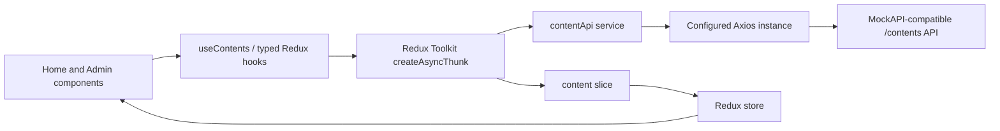

# Chill Movie Apps

Chill Movie Apps is a responsive movie and series catalog interface. It displays a curated home-page catalog and provides an admin area for managing the content records that power it. Content is fetched from a configurable HTTP API and grouped into viewing-oriented sections such as continue watching, films, trending titles, and series releases.

## Features

- Displays film and series content in horizontally scrollable catalog sections.
- Categorizes content by **Continue Watching**, film type, trending status, and series type.
- Includes a responsive admin catalog at `/admin`:
  - create, view, edit, and delete content records;
  - filter by film or series and search by title;
  - paginate filtered results (10 records per page);
  - use a desktop table or mobile-friendly card list depending on viewport size.
- Uses different, validated fields for films and series. The form validates required metadata, genres, and image selection before submission.
- Supports poster and banner image previews for JPG, PNG, and WebP files up to 2 MB.
- Handles initial loading, empty data, API errors, and retrying a failed initial fetch on the home page.
- Includes responsive navigation, catalog, hero, authentication-page layouts, and admin sidebar behavior.

## Tech Stack

| Area | Technology |
| --- | --- |
| UI | React 19, TypeScript |
| Build tooling | Vite 7, `@vitejs/plugin-react` |
| Styling | Tailwind CSS 4 via `@tailwindcss/vite` |
| Routing | React Router DOM 7 |
| State | Redux Toolkit 2, React Redux 9 |
| HTTP | Axios |
| SVG imports | `vite-plugin-svgr` |
| API backend | A MockAPI-compatible REST endpoint, configured at runtime |

## Project Structure

```text
.
+-- public/
|   `-- assets/                 # Static logos, icons, backgrounds, posters, and banners
+-- src/
|   +-- assets/                 # Source SVG assets
|   +-- components/
|   |   +-- atoms/              # Reusable primitive controls
|   |   +-- molecules/          # Composite UI controls (search, pagination, inputs)
|   |   +-- organisms/          # Catalog, navigation, footer, and hero UI
|   |   +-- admin/              # Admin form, toolbar, table/list, and sidebar
|   |   `-- templates/          # Shared authentication-page template
|   +-- hooks/                  # Content-state access and action wrapper
|   +-- layouts/                # Public and admin route layouts
|   +-- pages/                  # Home, login, register, and admin pages
|   +-- routes/                 # Browser-router configuration
|   +-- services/api/           # Axios client and content API functions
|   +-- stores/redux/           # Redux store, slice, and typed hooks
|   +-- types/                  # Content, navigation, and catalog view types
|   +-- utils/                  # Content normalization and object-URL cleanup
|   +-- main.tsx                # Application and provider bootstrap
|   `-- styles.css              # Tailwind import, theme tokens, and global styles
+-- archive/
|   `-- zustand/                # Previous Zustand implementation, retained for reference
+-- .env.example                # API base-URL variable template
+-- package.json
`-- vite.config.js
```

`archive/` is not part of the running application. It contains the previous Zustand implementation, retained for reference. The active application uses Redux Toolkit.

## Architecture and Data Flow

The app keeps content state in the `content` Redux slice. UI code uses the `useContents` hook for initial loading and CRUD actions, while typed `useAppDispatch` and `useAppSelector` hooks connect React components to the store safely.



1. `axios.ts` creates a client with the `VITE_API_BASE_URL` base URL, a 10-second timeout, JSON headers, and development-only request/error logging.
2. `contentApi.ts` isolates HTTP operations from the UI.
3. The `content` slice uses `createAsyncThunk` for fetching, creating, updating, and deleting records. It stores records, per-operation loading flags, fetch status, and an error message.
4. `useContents` dispatches the initial fetch once and exposes `create`, `update`, `remove`, and `retry` methods to pages.
5. The home page derives its sections from Redux state. The admin page derives its local search, filter, and pagination results from the same state.

## API Configuration

Create a `.env` file in the project root and set the only configured variable:

```dotenv
VITE_API_BASE_URL=https://YOUR_PROJECT.mockapi.io/api/v1
```

The configured base URL must expose the following REST resource, which the application treats as a MockAPI-compatible service:

| Operation | Method | Path |
| --- | --- | --- |
| List content | `GET` | `/contents` |
| Create content | `POST` | `/contents` |
| Update content | `PUT` | `/contents/:id` |
| Delete content | `DELETE` | `/contents/:id` |

No API credentials or secrets are defined in the source configuration. Keep `.env` local; it is ignored by Git.

## Installation and Setup

```bash
git clone YOUR_REPOSITORY_URL
cd chill-movie-apps
npm install
```

Copy the environment template, then set a reachable API base URL:

```bash
cp .env.example .env
```

On PowerShell, use:

```powershell
Copy-Item .env.example .env
```

Update `.env` as described in [API Configuration](#api-configuration), then start the development server:

```bash
npm run dev
```

Open the local URL printed by Vite. The public catalog is available at `/`, and content management is at `/admin`.

## Available Scripts

| Command | Description |
| --- | --- |
| `npm run dev` | Start the Vite development server. |
| `npm run build` | Produce a production build. |
| `npm run preview` | Serve the production build locally. |
| `npm run typecheck` | Run TypeScript without emitting files. |

## State Management

Redux Toolkit is the active state-management solution.

- `src/stores/redux/store.ts` registers the `content` reducer.
- `src/stores/redux/slices/contentSlice.ts` owns catalog records, request states, errors, and async CRUD reducers.
- `src/stores/redux/hooks.ts` exports typed dispatch and selector hooks based on `AppDispatch` and `RootState`.
- `src/hooks/useContents.ts` centralizes fetching and exposes UI-friendly content actions.

The archived `archive/zustand/contentStore.ts` file is retained for reference and is not imported by the active application. Zustand is neither an installed dependency nor part of the runtime state flow.

## Limitations

- The login and registration routes currently render forms but do not submit credentials, authenticate users, or protect routes.
- The hero content is static and is not selected from API data.
- Admin pagination, search, and type filtering run in the browser over the already fetched catalog; the API is not queried with pagination or filter parameters.
- Image selection creates browser `blob:` URLs for immediate preview. The application does not upload image files or convert them to durable storage. If a `blob:` URL is saved to the API, it is only meaningful for the browser session that created it and will not survive a page reload or work for other users. Static image filenames continue to resolve from `public/assets/posters` and `public/assets/banners`.
- Errors from create, update, and delete are retained in Redux state, but the admin page does not render a dedicated visible error message for those operations.

## Future Improvements

These are potential enhancements, not current functionality:

- Add authentication, authorization, and route protection for the admin area.
- Add a persistent image-upload service and store durable image URLs.
- Move search, filtering, and pagination to the API for larger catalogs.
- Make hero content and public navigation destinations data-driven.
- Surface mutation success and error feedback in the admin interface.
